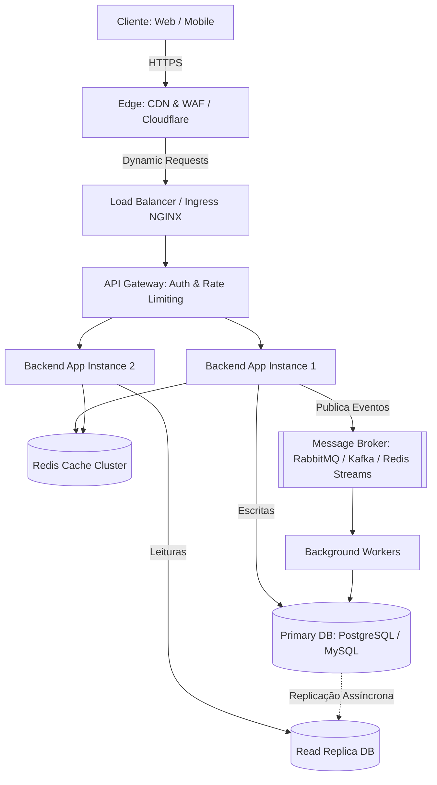

# System Design Skill

Use esta skill para projetar, avaliar ou revisar a arquitetura de sistemas, estimar capacidade de tráfego e armazenamento, definir estratégias de particionamento e consistência de dados, e aplicar padrões de alta disponibilidade e resiliência.

---

## 1. Framework de System Design em 5 Passos

```
┌─────────────────────────────────┐
│ 1. Clarificação de Requisitos   │ → FRs vs NFRs (SLAs quantificados)
└────────────────┬────────────────┘
                 ▼
┌─────────────────────────────────┐
│ 2. Estimativas de Capacidade    │ → Back-of-the-envelope (QPS, Banda, Storage, RAM)
└────────────────┬────────────────┘
                 ▼
┌─────────────────────────────────┐
│ 3. Arquitetura de Alto Nível    │ → Diagramas C4 (Context & Container), Gateway, EDA, DB
└────────────────┬────────────────┘
                 ▼
┌─────────────────────────────────┐
│ 4. Design Detalhado & Dados     │ → CAP/PACELC, Particionamento, Sharding, Caching
└────────────────┬────────────────┘
                 ▼
┌─────────────────────────────────┐
│ 5. Resiliência, SPOFs & Métricas│ → Circuit Breakers, Rate Limit, Idempotência, RED/USE
└─────────────────────────────────┘
```

---

## 2. Passo 1: Clarificação de Requisitos

Nunca inicie o design sem separar claramente os requisitos funcionais e não-funcionais:

### Requisitos Funcionais (FR)
- Quais são as 3 a 5 jornadas principais do usuário? (ex: criar pedido, processar pagamento, consultar histórico).
- Quais endpoints ou fluxos de dados essenciais sustentam essas jornadas?
- O que está explicitamente **fora de escopo** no MVP?

### Requisitos Não-Funcionais (NFR) com Metas Quantificadas
- **Disponibilidade**:
  - `99.9%` (três noves) = ~8,76 horas de downtime/ano (aceitável para a maioria dos MVPs).
  - `99.99%` (quatro noves) = ~52,6 minutos de downtime/ano (exige multi-AZ, failover automatizado).
- **Latência**:
  - Leitura (p95 / p99): ex. `< 100ms` em APIs públicas.
  - Escrita: ex. `< 200ms` síncrono ou processamento assíncrono com ack imediato em `< 50ms`.
- **Consistência (CAP/PACELC)**:
  - Consistência Forte (ACID): Crítico para pagamentos, estoque, dados contábeis.
  - Consistência Eventual (BASE): Aceitável para feeds, notificações, contadores sociais, dashboards analíticos.
- **Durabilidade & RTO/RPO**:
  - **RTO (Recovery Time Objective)**: Tempo máximo aceitável para restaurar o sistema após um desastre.
  - **RPO (Recovery Point Objective)**: Quantidade máxima aceitável de perda de dados em tempo (ex: backup a cada 1h -> RPO = 1h).

---

## 3. Passo 2: Estimativas de Capacidade (Back-of-the-Envelope)

### Regras Práticas de Conversão Rápida
- `1 dia = 86.400 segundos` (aproxime para `10^5` para cálculos mentais rápidos).
- `1 milhão de requisições/dia` ≈ `12 QPS médios` (pico geralmente de `24` a `60 QPS`).
- `10 milhões de requisições/dia` ≈ `116 QPS médios`.

### Fórmulas Essenciais

#### Tráfego (QPS)
```
QPS Médio = (DAU * Requisições Médias por Usuário) / 86.400
QPS de Pico = QPS Médio * Fator de Pico (habitualmente 2x a 5x)
QPS de Leitura vs Escrita = Separar conforme o perfil da aplicação (ex: 10:1 ou 100:1)
```

#### Armazenamento (Storage)
```
Volume Diário = QPS de Escrita * 86.400 * Tamanho Médio do Registro (bytes)
Storage em 1 Ano = Volume Diário * 365 * 1.3 (overhead de 30% para índices e metadados)
Storage em 5 Anos = Storage em 1 Ano * 5 * Fator de Replicação (ex: 3x para réplicas de leitura/backup)
```

#### Banda de Rede (Throughput)
```
Ingress (Entrada) = QPS de Escrita * Tamanho Médio do Payload de Entrada
Egress (Saída)   = QPS de Leitura * Tamanho Médio do Payload de Saída
```

#### Memória e Dimensionamento de Cache (Regra 80/20 de Pareto)
```
20% das entidades ativas geram 80% do tráfego de leitura.
Memória de Cache Necessária = Volume Diário de Leitura * 0.20
```

### Tabela de Referência de Latências de Hardware (Jeff Dean Numbers)
| Operação | Tempo Típico | Escala Relativa |
|---|---|---|
| L1 cache reference | 0.5 ns | 1x |
| L2 cache reference | 7 ns | 14x |
| RAM access | 100 ns | 200x |
| Ler 1 MB sequencialmente da RAM | 250 μs (0.25 ms) | 500.000x |
| Ler 1 MB sequencialmente do SSD (NVMe) | 1.000 μs (1 ms) | 2.000.000x |
| Round trip na mesma rede local (datacenter) | 500 μs (0.5 ms) | 1.000.000x |
| Round trip cross-region / Internet (ex: SP -> US) | 100 - 150 ms | 300.000.000x |

---

## 4. Passo 3: Arquitetura de Alto Nível & Comunicação

### Seleção do Estilo Arquitetural
- **Monólito Modular**: Ideal para times pequenos, baixa complexidade de domínio e velocidade inicial de MVP com boundaries bem definidos.
- **Event-Driven Architecture (EDA)**: Indicado quando há necessidade de desacoplamento, tarefas demoradas em segundo plano e escalabilidade de escrita independente.
- **Microsserviços**: Justificado apenas quando múltiplos times autônomos precisam de deploy independente e há requisitos de escala heterogêneos entre módulos.

### Diagrama C4 - Container (Template Mermaid)


---

## 5. Passo 4: Estratégias de Dados e Caching

### Relacional (SQL) vs Não-Relacional (NoSQL)
| Critério | Relacional (PostgreSQL, MySQL) | NoSQL (MongoDB, DynamoDB, Cassandra) |
|---|---|---|
| Modelo de Dados | Esquema rígido, normalizado, joins complexos | Documento flexível, chave-valor ou wide-column |
| Transações | ACID com isolamento rigoroso | Consistência eventual ou ACID em nível de documento |
| Escala Típica | Vertical + Read Replicas (Sharding manual) | Horizontal nativo por partição de chave |
| Casos de Uso | Finanças, ERP, E-commerce relacional, Auth | Catálogo dinâmico, feeds, analytics, logs, IoT |

### Padrões de Caching
1. **Cache-Aside (Lazy Loading)**:
   - A aplicação consulta o cache; se der `cache miss`, busca no banco e grava no cache com TTL.
   - Ideal para leitura intensiva. Cuidado com *Cache Stampede*.
2. **Write-Through**:
   - A aplicação grava no cache e no banco simultaneamente antes de confirmar.
3. **Write-Behind (Write-Back)**:
   - A aplicação grava no cache e confirma; um worker persiste assincronamente no banco em lote.
   - Alto throughput de escrita; risco de perda de dados se o nó do cache cair antes do flush.

### Mitigação de Problemas Críticos de Cache
- **Cache Stampede / Thundering Herd**: Quando uma chave muito acessada expira e milhares de requisições batem simultaneamente no banco.
  - *Solução*: Usar mutex/lock distribuído para regeneração de chave única, ou expiração probabilística (*XFetch* / *early recomputation*).
- **Cache Penetration**: Consultas por chaves inexistentes que sempre batem no banco.
  - *Solução*: Guardar no cache valores nulos com TTL curto (`TTL = 60s`) ou usar *Bloom Filter*.
- **Cache Avalanche**: Milhares de chaves expirando no mesmo segundo derrubam o banco.
  - *Solução*: Adicionar *Jitter* aleatório ao TTL (ex: `TTL = 3600s + rand(0, 300s)`).

### Padrão Transactional Outbox (Consistência em Mensageria)
Ao salvar dados no banco e emitir um evento para uma fila:
- **Problema**: Se salvar no banco e a fila falhar, ou se postar na fila e o commit do banco falhar, o estado fica inconsistente.
- **Solução**: Na mesma transação SQL local, grave a entidade de negócio e insira o evento em uma tabela `outbox`. Um processo background (CDC ou poller com Debezium/Worker) lê a tabela `outbox` e publica no broker com confirmação de entrega.

---

## 6. Passo 5: Resiliência, Escalabilidade & Tolerância a Falhas

### 1. Single Point of Failure (SPOF)
- Identificar todo componente único cuja queda derrube o sistema inteiro:
  - Banco de dados sem réplica ou failover automático.
  - Instância única de backend.
  - Gateway sem redundância.
- **Ação obrigatória**: Todo componente crítico em produção deve possuir redundância (mínimo de 2 nós) e health check com failover.

### 2. Padrões de Tolerância a Falhas
- **Circuit Breaker**:
  - `Closed`: Requisições passam normalmente.
  - `Open`: Erros consecutivos atingem o limiar (ex: 50% de falha em 10s); chamadas são abortadas imediatamente com fallback sem onerar o serviço dependente.
  - `Half-Open`: Após um tempo de espera (ex: 30s), algumas requisições de teste passam para verificar se o serviço se recuperou.
- **Rate Limiting**:
  - Implementar no API Gateway ou middleware via Redis com algoritmo **Token Bucket** ou **Sliding Window Log** para proteger contra abuso e DDoS acidental.
- **Idempotência**:
  - Todo endpoint de mutação (`POST /orders`, `POST /payments`) deve aceitar um cabeçalho `Idempotency-Key: <UUID>`.
  - Se a mesma chave for reenviada, retorne o resultado previamente calculado sem duplicar a cobrança ou o registro.
- **Retries com Exponential Backoff e Full Jitter**:
  - Evitar retries imediatos que criam tempestades de requisições sincronizadas.
  ```python
  sleep = min(max_delay, base_delay * (2 ** attempt)) * random.uniform(0, 1)
  ```

---

## 7. Observabilidade por Design

A arquitetura deve nascer instrumentada:

### Métricas RED (Para APIs e Serviços)
- **R (Rate)**: Número de requisições por segundo.
- **E (Errors)**: Número de requisições que falharam (HTTP 5xx / 4xx).
- **D (Duration)**: Latência das requisições distribuída em percentis (p50, p95, p99).

### Métricas USE (Para Recursos de Infraestrutura)
- **U (Utilization)**: Percentual de tempo em que o recurso esteve ocupado (CPU, RAM, Disco).
- **S (Saturation)**: Trabalho em fila aguardando processamento (tamanho da fila de conexões, backlog).
- **E (Errors)**: Erros de hardware ou sistema operacional (drops de pacotes, disk I/O errors).

### Health Checks Padronizados
- `/healthz/live` (Liveness): O processo da aplicação está vivo? (se falhar, o orquestrador reinicia o contêiner).
- `/healthz/ready` (Readiness): O processo está apto a receber tráfego? (valida conexões ativas com banco e cache; se falhar, o balanceador retira a instância da rota temporariamente).

---

## 8. Template de ADR (Conforme decision.schema.json)

Toda decisão arquitetural estruturante deve ser documentada em `.opencode/memory/decisions/ADR-XXX-[titulo].md` contendo:

```markdown
# ADR-[ID]: [Título Claro e Conciso]

Status: proposed | accepted | rejected | superseded
Data: YYYY-MM-DD
Autor: Architect (ou Tech Lead)
Fonte: [Requisitos do projeto, análise de trade-offs, reunião com usuário]

## Contexto
[Descrição do problema técnico ou de negócio, restrições e objetivos quantificados]

## Decisão
[A tecnologia, padrão ou abordagem escolhida com justificativa técnica]

## Alternativas Consideradas
- **[Alternativa A]**: [Por que não foi escolhida, trade-offs]
- **[Alternativa B]**: [Por que não foi escolhida, trade-offs]

## Impacto
- **Componentes afetados**: [Lista de serviços, bancos, repositórios]
- **Riscos e Mitigações**:
  - [Risco 1]: [Mitigação 1]
- **Migração necessária**: [Passo de migração ou 'Nenhuma']

## Critérios de Validação
- [ ] [Critério 1 verificável por teste ou comando]
- [ ] [Critério 2 verificável por métrica ou exit code]
```
